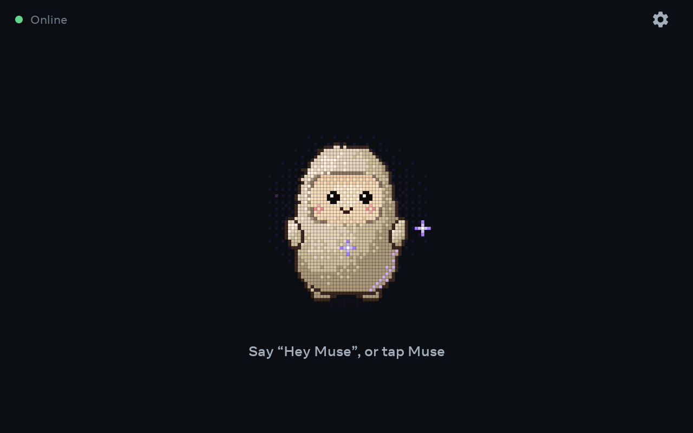
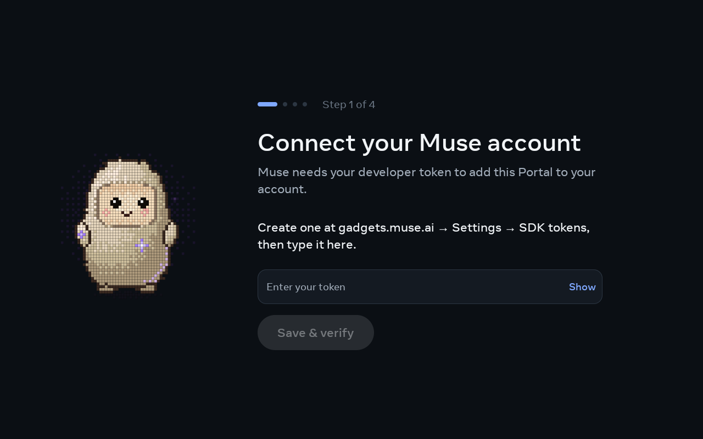
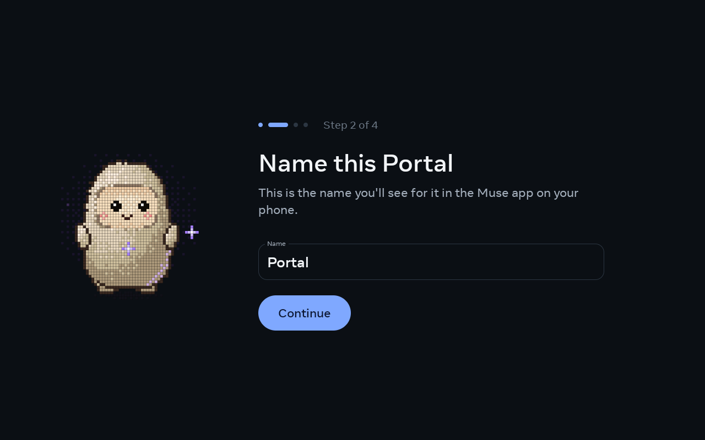
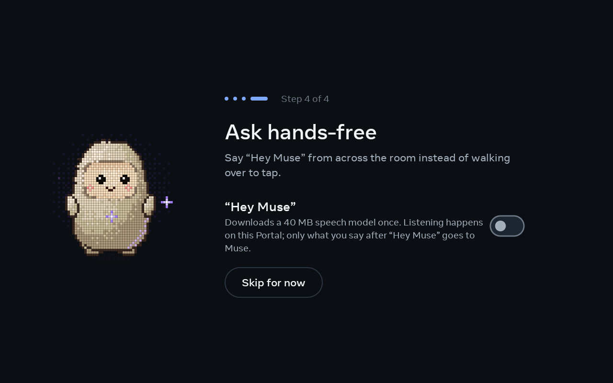
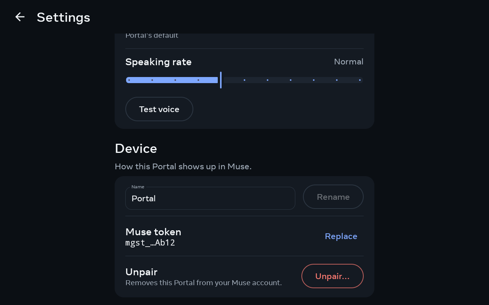
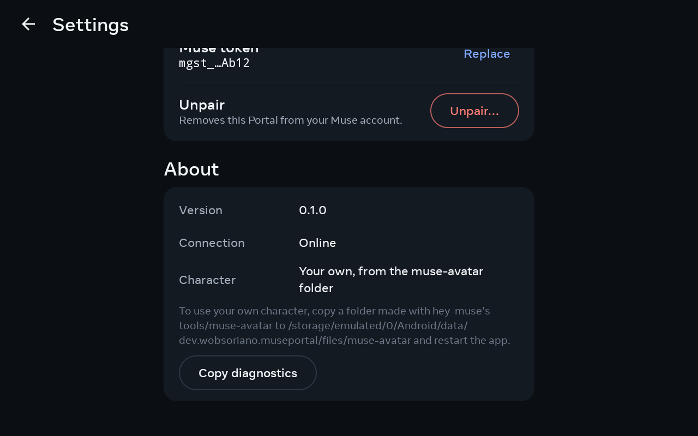

# Muse for Portal

Meta's Muse on a Meta Portal (first generation, Android 9), as a sideloaded Android app. No root:
Portal's bootloader stays locked, and Meta's own ADB support is all it needs.

### Screenshots

<table>
  <tr>
    <td width="50%"><br><sub><b>Home</b>: Muse waits for "Hey Muse" or a tap</sub></td>
    <td width="50%"><br><sub><b>Answer</b>: the question small, Muse's answer under it, spoken aloud</sub></td>
  </tr>
  <tr>
    <td colspan="2"><br><sub><b>Anywhere</b>: say "Hey Muse" from another app and a bar shows the turn over it</sub></td>
  </tr>
</table>

#### Setting up

<table>
  <tr>
    <td width="50%"><br><sub><b>1. Token</b>: paste the SDK token from gadgets.muse.ai</sub></td>
    <td width="50%"><br><sub><b>2. Name</b>: how this Portal shows up in the Muse app</sub></td>
  </tr>
  <tr>
    <td width="50%"><br><sub><b>3. Pair</b>: add the Portal from the Muse phone app over Bluetooth</sub></td>
    <td width="50%"><br><sub><b>4. Hey Muse</b>: turn on hands-free listening</sub></td>
  </tr>
</table>

#### Settings

<table>
  <tr>
    <td width="33%"><br><sub><b>Hey Muse and voice</b></sub></td>
    <td width="33%"><br><sub><b>Speaking rate and device</b></sub></td>
    <td width="33%"><br><sub><b>Token, unpair and about</b></sub></td>
  </tr>
</table>

- `android/muse` is the Muse library, plain Kotlin with no Android code, so its tests run on a PC. It
  holds the Muse client and the gadget pairing protocol, ported to Kotlin from the Go core of
  [hey-muse](https://github.com/wobsoriano/hey-muse), the TECHO5 fork that runs Muse on Echo devices.
  `MuseCore` is the app's way in: config, pairing, BLE events and questions go in, and the
  connection, pairing and reply status come out.
- `android/app` is the app: the Bluetooth LE side of pairing, the microphone, the "Hey Muse"
  listener, playback and the screen. It runs `MuseCore` in its own process.
- `android/probe` is a separate app that reports what a Portal allows on day one.
- `android/wake` is the "Hey Muse" rule for Vosk: the grammar to decode with and how to decide a
  result. `tools/wakeeval` applies the same rule to a recording on the PC.
- `third_party/pico` is the SVOX Pico speech engine.

## Status

Tap Muse to ask, or turn on **Hey Muse** to ask hands-free. The first time it is turned on, the
app downloads Vosk's `vosk-model-small-en-us-0.15` (41 MB, checked against a pinned SHA-256) into
its files directory. The listener runs in the app's foreground service and starts at boot when it is
on. It lets go of the microphone while another app records. If
[portal-wake](https://github.com/rudysev/portal-wake) is installed, the app does not listen itself:
it registers "hey muse" with portal-wake and answers its hand-offs.

## Build

You need JDK 21 and the Android SDK (platform 35).

```sh
android/gradlew -p android :muse:test :wake:test :app:testDebugUnitTest :app:assembleDebug :probe:assembleDebug
```

`:muse:test` includes the cross-language check: the Noise sessions, frames, chunks, pairing
conversations and state files that the Go core wrote are committed under
`android/muse/src/test/resources/vectors`, and the Kotlin code has to reproduce them byte for byte.
That folder's README says how they were made.

## Install on a Portal

Turn on **Settings > Debug > ADB Enabled** on the Portal, connect it over USB-C and allow the
computer. Then:

```sh
adb install -g android/probe/build/outputs/apk/debug/probe-debug.apk
adb shell am start -n dev.wobsoriano.museportal.probe/.ProbeActivity
adb logcat -s MuseProbe        # the day-one report
adb push vosk-model-small-en-us-0.15 /sdcard/Android/data/dev.wobsoriano.museportal.probe/files/
adb shell am start -n dev.wobsoriano.museportal.probe/.ProbeActivity -S --es only vosk   # two minutes of "Hey Muse" on Vosk
adb install -g android/app/build/outputs/apk/debug/app-debug.apk
```

To skip the download, copy in a model you already have (a debug build allows `run-as`):

```sh
adb push vosk-model-small-en-us-0.15 /data/local/tmp/
adb shell run-as dev.wobsoriano.museportal cp -r /data/local/tmp/vosk-model-small-en-us-0.15 files/vosk-model-small-en-us-0.15.tmp
adb shell run-as dev.wobsoriano.museportal mv files/vosk-model-small-en-us-0.15.tmp files/vosk-model-small-en-us-0.15
adb shell am start -n dev.wobsoriano.museportal/.MainActivity --ez heyMuse true
adb logcat -s MuseWake
```

The app keeps its pairing in `muse.json` in its files directory, in the format the Go core wrote,
so a Portal paired by an earlier build stays paired.

The Vosk check saves its audio as `files/vosk.wav`. `tools/wakeeval/eval.py` replays a WAV through the
same rule on the PC and scores it against a file of attempt times.

## Licences

`android/muse` is a modified port of Meta's Muse Gadget SDK (Apache 2.0, see its `LICENSE`), by way
of hey-muse's Go port. Its test vectors in `android/muse/src/test/resources/pairing` are Meta's
(Apache 2.0). `third_party/pico` is SVOX Pico (Apache 2.0). What came from hey-muse is MIT:
`LICENSE.hey-muse`, `NOTICE.hey-muse`.

The character in `android/app/src/main/assets/muse-avatar/` and the launcher icons made from it are
Meta's default Muse gadget avatar ("Jollybot") from
[facebookincubator/muse-gadget-sdk](https://github.com/facebookincubator/muse-gadget-sdk). The SDK's
Apache license does not cover it; it is included at the project owner's choice. Replacing the files
in `assets/muse-avatar/` swaps it, and `tools/make-icon/MakeIcon.java` remakes the icons from the new
`idle.png`. A set copied to the app's `files/muse-avatar/` on the device takes precedence over the
built-in one.
